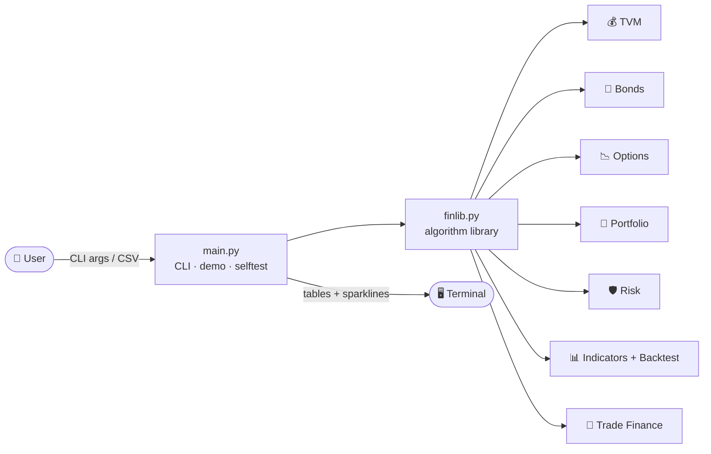

<div align="center">


# 📈 QuantLedger

**A production-style, zero-dependency Python toolkit of financial algorithms.**
Time value of money · Bonds · Options · Portfolio optimisation · Risk · Indicators · Backtesting · Import-export trade costing

<p>
  
  
  
  
</p>
<p>
  
  
  
  
</p>

[🚀 Quick Start](#-quick-start) •
[🧮 Algorithms](#-algorithm-catalogue) •
[💻 CLI](#-command-line-interface) •
[🐍 Python API](#-python-api) •
[🏗 Architecture](#-architecture) •
[🗺 Roadmap](#-roadmap) •
[🤝 Contributing](#-contributing)

</div>

---

## ✨ Why QuantLedger?

| | Feature | Details |
|---|---|---|
| 🪶 | **Zero dependencies** | Only the Python standard library. No `numpy`, no `pandas`, no installs. Runs anywhere Python runs. |
| 🧠 | **Algorithms from first principles** | Gaussian elimination, bisection solvers, binomial trees and Monte Carlo are implemented by hand, so every line is readable and teachable. |
| ✅ | **Verified** | A built-in self-test checks 21 results against textbook values (Black-Scholes, put-call parity, bond round trips and more). |
| 🌍 | **Trade-finance aware** | Landed cost, import profitability with financing carry, and covered-interest-parity forward FX. Few toolkits cover this. |
| 🖥 | **CLI and library** | Use it from the terminal or `import finlib` in your own project. |
| 🔁 | **Reproducible** | Seeded random generators give identical results on every run. |

---

## 🚀 Quick Start

```bash
# 1. Clone
git clone https://github.com/<your-username>/quantledger.git
cd quantledger

# 2. Verify everything works (no installs needed)
python main.py selftest

# 3. See every module in action
python main.py demo
```

> **Requirements:** Python 3.9 or newer. That is all.

---

## 🧮 Algorithm Catalogue

<details open>
<summary><b>1️⃣ Time Value of Money</b></summary>

| Function | What it does |
|---|---|
| `future_value`, `present_value` | Compounding and discounting, with optional annuity payments |
| `loan_payment`, `amortization_schedule` | Level payment and a full interest/principal/balance table |
| `npv`, `irr` | Net present value and a bisection-based internal rate of return |
| `cagr`, `effective_annual_rate` | Growth rates and nominal-to-effective conversion |

</details>

<details open>
<summary><b>2️⃣ Fixed Income</b></summary>

| Function | What it does |
|---|---|
| `bond_price` | Prices a coupon bond at any yield and payment frequency |
| `bond_ytm` | Yield to maturity via a robust bisection solver |
| `bond_duration` | Macaulay and modified duration |
| `bond_convexity` | Second-order price sensitivity, used for shock estimates |

</details>

<details open>
<summary><b>3️⃣ Derivatives</b></summary>

| Function | What it does |
|---|---|
| `black_scholes` | European call/put price plus **Delta, Gamma, Vega, Theta, Rho**, with dividend yield |
| `implied_volatility` | Recovers volatility from a market price |
| `binomial_option` | Cox-Ross-Rubinstein tree with **American early exercise** |
| `monte_carlo_option` | Antithetic-variate simulation with standard error |

</details>

<details open>
<summary><b>4️⃣ Portfolio Theory</b></summary>

| Function | What it does |
|---|---|
| `cov_matrix`, `solve_linear` | Sample covariance and a pivoting linear solver |
| `min_variance_weights` | Global minimum-variance portfolio |
| `max_sharpe_weights` | Tangency portfolio (maximum Sharpe ratio) |
| `efficient_frontier` | Random long-only sampling reduced to the efficient envelope |

Long-only mode uses an active-set heuristic (drop the most negative weight and re-solve). It is fast and sensible for teaching, but it is not a full quadratic-programming solver.

</details>

<details open>
<summary><b>5️⃣ Risk & Position Sizing</b></summary>

`sharpe_ratio` · `sortino_ratio` · `max_drawdown` · `historical_var` · `parametric_var` · `cvar` · `kelly_fraction` · `position_size`

</details>

<details open>
<summary><b>6️⃣ Technical Indicators & Backtesting</b></summary>

`sma` · `ema` · `rsi` (Wilder) · `macd` · `bollinger` · `backtest_sma_crossover` (no look-ahead, transaction costs included) · `gbm_path` (synthetic prices)

</details>

<details open>
<summary><b>7️⃣ Trade Finance (Import / Export)</b></summary>

| Function | What it does |
|---|---|
| `landed_cost` | FOB → CIF → duty → tax → total and per-unit cost |
| `import_profitability` | Profit, margin, markup and break-even price, including inventory financing cost |
| `forward_fx_rate` | Forward exchange rate from covered interest parity |

</details>

---

## 💻 Command-Line Interface

```bash
python main.py demo                                   # everything, with sample data
python main.py selftest                               # verify against known values

python main.py loan --principal 5000000 --rate 0.12 --years 5 --schedule 6
python main.py bond --face 1000 --coupon 0.06 --ytm 0.07 --years 10
python main.py option --spot 100 --strike 105 --time 0.5 --rate 0.05 --vol 0.25 --type call
python main.py portfolio --csv prices.csv --rf 0.03
python main.py backtest --csv prices.csv --fast 20 --slow 50 --cost 5
python main.py trade --fob 12.5 --qty 4000 --freight 3500 --insurance 0.01 \
                     --duty 0.20 --tax 0.18 --sell 28 --financing 0.15 --days 45 \
                     --spot 280 --dom-rate 0.12 --for-rate 0.05 --fx-years 0.5
```

**CSV format** for `portfolio` and `backtest`: a header row of tickers, then one row of prices per period.

```csv
AAPL,MSFT,GOOG
187.2,402.1,141.5
188.0,404.7,142.3
```

---

## 📊 Sample Output

Real output from `python main.py demo` (synthetic, seeded data):

```text
[BOND] 10y 6% coupon @7% yield -> price 928.94 | duration 7.559y | modified 7.304 | convexity 66.91
[OPT]  call S=100 K=105 T=0.5 -> 5.9885 | delta 0.482 gamma 0.0225 vega 0.282 theta/day -0.025

Asset      Ann.Ret   Ann.Vol    MinVar  MaxSharpe
TECH        22.40%    30.42%    11.65%     11.30%
BANK        20.87%    17.96%    40.25%     35.35%
TRADE       21.96%    21.79%    27.65%     26.18%
ENERGY      28.95%    25.06%    20.46%     27.18%

Equal weight  return   23.55% | vol  12.75% | Sharpe 1.611
Min variance  return   23.00% | vol  11.78% | Sharpe 1.698
Max Sharpe    return   23.52% | vol  11.93% | Sharpe 1.720
```

```text
IMPORT / EXPORT TRADE COSTING
Fob Value   :        50,000.00
Freight     :         3,500.00
Insurance   :           535.00
Cif         :        54,035.00
Duty        :        10,807.00
Tax         :        11,671.56
Total       :        77,713.56
Per unit    :            19.43

Profit       : 32,849.27
Margin       : 29.33%
Break-even   : 19.79 per unit
```

> The demo backtest is run on random synthetic prices, so its result (a small loss versus buy-and-hold) says nothing about the strategy's real-world merit. It exists to show the engine working.

---

## 🐍 Python API

```python
import finlib as fl

# Loan: 1,000,000 at 10% over 5 years
payment = fl.loan_payment(1_000_000, 0.10 / 12, 60)

# Bond price, duration and convexity
price = fl.bond_price(1000, coupon_rate=0.06, ytm=0.07, years=10)
mac, mod = fl.bond_duration(1000, 0.06, 0.07, 10)

# Option with Greeks
g = fl.black_scholes(spot=100, strike=105, t=0.5, rate=0.05, vol=0.25, kind="call")
print(g.price, g.delta, g.gamma, g.vega, g.theta, g.rho)

# Optimal portfolio from your own return data
w = fl.max_sharpe_weights(mu=[0.12, 0.09], cov=[[0.04, 0.006], [0.006, 0.02]], rf=0.03)

# Importer's landed cost
cost = fl.landed_cost(fob_price=12.5, quantity=4000, freight=3500, duty_rate=0.20, tax_rate=0.18)
print(cost["per_unit"])
```

---

## 🏗 Architecture



```text
quantledger/
├── finlib.py   # the library: every algorithm, typed and documented
├── main.py     # CLI, demo, and 21-check self-test suite
└── README.md   # you are here
```

---

## 🔬 Testing

```bash
python main.py selftest
# 21/21 checks passed
```

Checks include Black-Scholes against known reference prices, put-call parity, YTM and implied-volatility round trips, binomial convergence to Black-Scholes, Monte Carlo within four standard errors, and a hand-computed landed cost.

---

## 🗺 Roadmap

- [ ] Value-at-Risk backtesting (Kupiec test)
- [ ] Barrier and Asian options via Monte Carlo
- [ ] Yield-curve bootstrapping and Nelson-Siegel fitting
- [ ] Full quadratic-programming frontier with constraints
- [ ] Letter-of-credit and Incoterms cost modules
- [ ] Optional plotting module (matplotlib) kept separate from the zero-dependency core

---

## 🤝 Contributing

1. Fork the repository and create a branch: `git checkout -b feature/your-idea`
2. Add your algorithm to `finlib.py` with type hints and a docstring
3. Add at least one known-value check to `cmd_selftest` in `main.py`
4. Run `python main.py selftest` and confirm everything passes
5. Open a pull request describing the maths and your source

---

## ⚠️ Disclaimer

QuantLedger is **educational software**. Outputs are model estimates built on simplifying assumptions (constant volatility, normal returns, frictionless markets). Nothing here is investment, tax or legal advice. Verify results independently before committing real money.

---

<div align="center">

**Built with ❤️ by Hassan Khan**

<a href="https://github.com/<your-username>"></a>
<a href="https://linkedin.com/in/<your-handle>"></a>

⭐ If this project helped you learn, please star the repo.


</div>
